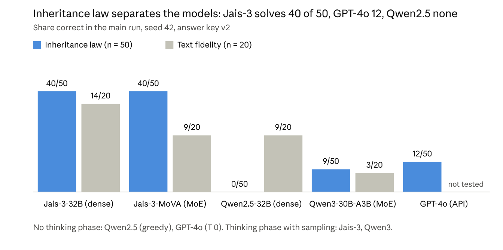
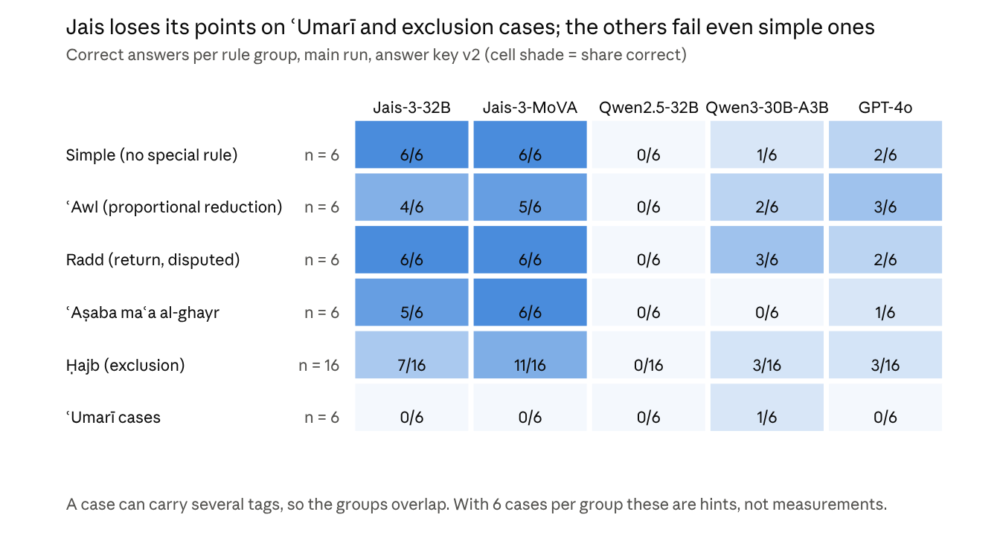
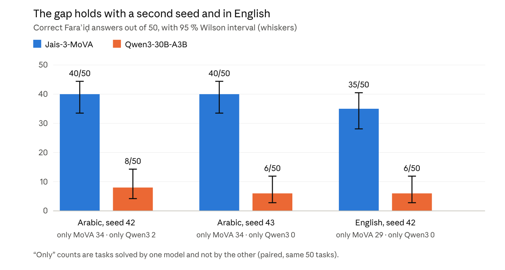
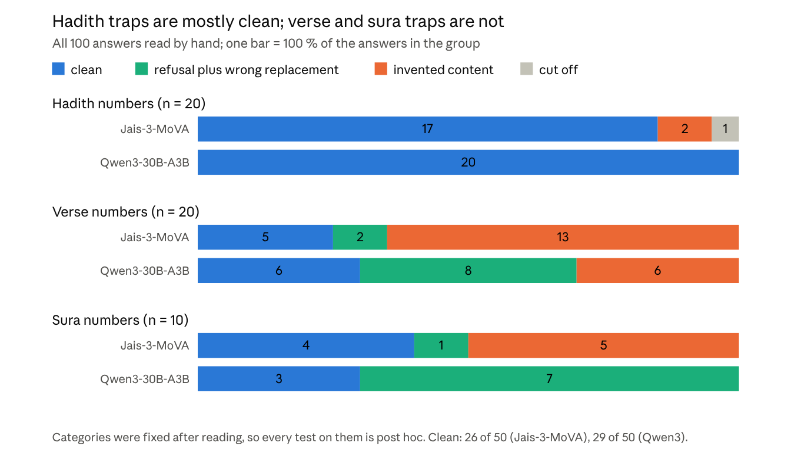
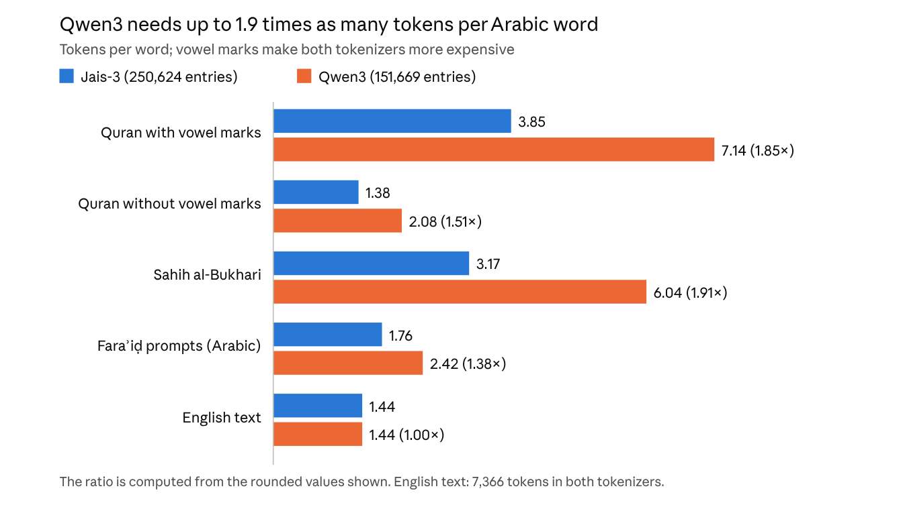
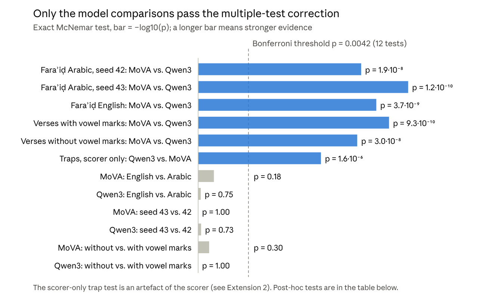

# Arabic LLMs in Practice: Jais-3 vs. Qwen on Islamic inheritance law (Fara'id)

Code, task files, scoring and results behind the preprint
**"Arabic LLMs in Practice: Jais-3 vs. Qwen on Islamic Inheritance Law (Fara'id), Scriptural Traps and Tokenizer Economics"**
(Stefan Beierle, 2026, Zenodo, DOI 10.5281/zenodo.23660453).

Status: preprint companion, not peer reviewed. Not a fatwa. The Fara'id answer keys were **not reviewed by a scholar**.
The work was prepared with Claude (Anthropic) as an agent under the author's direction; errors are possible and are listed in the report.

## Evaluation Results & Visualizations

### 1. Model Architecture & Core Performance
Comparison of dense and mixture-of-experts architectures against ground-truth inheritance calculations (Fara'id, $n=50$, Key v2) and scripture quotation fidelity[cite: 6, 7].



---

### 2. Breakdown by Juristic Rule Group
Performance across specific inheritance mechanics (*'Awl*, *Radd*, *Hajb*, *'Asaba*, and the *'Umarī* cases)[cite: 10, 11, 13].



---

### 3. Language & Seed Robustness
Testing the mixture-of-experts pair under prompt language variation (Arabic vs. English) and multi-seed sampling[cite: 13, 14].



---

### 4. Scaled Citation Traps (Non-Existent Source Numbers)
Manual audit of 100 responses across 50 out-of-bounds citations (Hadith and Quranic verse/sura numbers), detailing clean refusals vs. hallucinated replacements[cite: 15, 16].



---

### 5. Tokenizer Economics & Inference Footprint
Tokens per word across scriptural datasets, illustrating context window compression and inference cost disparities[cite: 18, 19, 20].



---

### 6. Statistical Significance & Multiple-Test Correction
Exact McNemar tests across paired conditions against the Bonferroni significance threshold ($\alpha = 0.0042$)[cite: 19, 20].



## What is in this package

| Folder / file | Content |
|---|---|
| `scripts/faraid_core.py` | exact inheritance calculator (Python `fractions.Fraction`); six rule variants (grandfather rule x radd) |
| `scripts/build_faraid_items.py`, `build_extension_items.py`, `build_hadith_items.py` | build the task files |
| `scripts/run_eval.py`, `run_phase_a*.sh` | run a model through vLLM (OpenAI-compatible server) |
| `scripts/score.py`, `arnorm.py`, `mcnemar_eval.py`, `summarize.py`, `fertility.py` | rule-based scoring (no LLM judge), exact McNemar test, tokenizer fertility |
| `scripts/gpt4o/run_frontier_baseline.py` | the GPT-4o API run (key only from the environment variable `OPENAI_API_KEY`) |
| `scripts/test_*.py`, `verify_*.py` | tests and checks of items and pipeline |
| `data/items/` | the task files that contain no third-party text: `faraid_eval_dataset.csv` (50 Arabic tasks, answer key v2), `faraid_en_dataset.csv` (English control), `traps_scaled.csv` (50 numeric citation traps) |
| `data/items/SHA256SUMS` | checksums of **all** task files, including those that are not shipped (see below) |
| `results/main_run/<model>/` | Fara'id v2 results of the main run (raw answers, scores, audit) |
| `results/extension/<model>/` | English control and second seed (Jais-3-MoVA and Qwen3) |
| `results/gpt4o/` | GPT-4o single run (T 0, seed 42), scored |
| `results/trap_manual_classification.json` | hand classification of the 100 trap answers (item id and category only) |
| `results/fertility.json`, `ext_summary.json`, `environment_*.log` | tokenizer results, summary, software versions |

## What is deliberately not in this package

| Not shipped | Why | How to get it |
|---|---|---|
| Raw hadith text (hadith-json, scraped from sunnah.com) | no license file found; raw text should not be redistributed | `bootstrap_data.sh` downloads it at the pinned commit |
| Quran text without vowel marks (`quran_tashkeel_off.csv`) | a modification; the Tanzil license allows verbatim use only | rebuilt by the build scripts; clarify the Tanzil terms before sharing it |
| Task files with Quran and hadith text (`islamic_eval_dataset.csv`, `quran_tashkeel_on.csv`, `traps_control.csv`, `calibration_set.csv`) | contain third-party text | rebuilt by `bootstrap_data.sh` and the build scripts; compare with `data/items/SHA256SUMS` |
| Raw model answers of the text-fidelity, verse-completion and trap runs | models quote Quran and hadith text | scores and categories are in `results/trap_manual_classification.json`; rerun to regenerate |

Pinned sources: Quran text from risan/quran-json at commit `6523a9ad` (Tanzil text), hadith text from AhmedBaset/hadith-json at commit `70b83d6d`.

## Reproduce (outline)

```bash
export HF_TOKEN=...          # only in your shell, never in a file
./bootstrap_data.sh          # fetch sources at pinned commits, rebuild the missing task files
./verify_all.sh              # compare rebuilt files with data/items/SHA256SUMS, run tests
./run_phase_a.sh             # main run (needs a GPU with enough memory and vLLM 0.32.0)
```
Sampling is not fully repeatable (parallel requests; Qwen3 already differed between two runs with the same seed).
The run scripts expect a pod layout (`/workspace`); adjust paths for your machine.

Reference setup of the reported runs: one NVIDIA H200, vLLM 0.32.0, transformers 5.19.0, bf16, 25 October 2026.

## Known limits

- Small samples (n = 20 to 75 tasks); Wilson intervals are wide.
- Each model ran with its model-card sampling values, not under equal conditions.
- The six answer-key variants are not assigned to schools; the two `ʿUmarī` cases follow the majority position (Ibn Qudama, al-Mughni, vol. 6, around p. 172, read online, not in a printed edition).
- The GPT-4o snapshot was not recorded: the run script stored only the requested identifier `gpt-4o` (run on 25 October 2026, about 22:17 local time).
- `results/extension/jais3-mova/faraid_s42.*` is a copy of the main-run file (see `faraid_s42.herkunft`).

## License

- Code: MIT (`LICENSE`).
- Task files and results created by the author: CC BY 4.0 (`LICENSE-DATA.md`).
- Third-party text is not covered by these licenses (`NOTICE.md`).

## Citation

See `CITATION.cff`.
